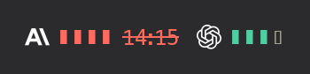
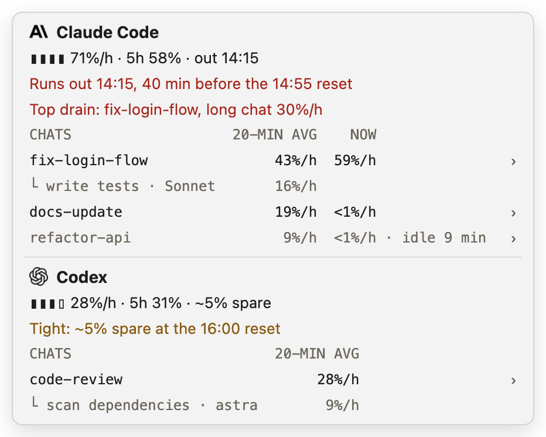
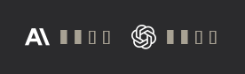

# ccrunway

ccrunway tells you when your Claude Code 5-hour limit runs out at your current pace, which chat
and what part of it is using the limit up, and what the next send will cost before you send it.
It adds one line under your Claude Code status line and keeps whatever status line you already
have. AI coding agents: see [For AI agents](#for-ai-agents).

```
ccrunway · pace ▮▮▯▯  12%/h · Opus 5.5 · 40k · 5h 1% · checking… · resets 2:35pm
ccrunway · pace ▮▮▯▯  18%/h · Opus 5.5 · 120k · 5h 45% · ✓ on track · ~15% spare at 2:35pm
ccrunway · pace ▮▮▮▯  21%/h · Opus 5.5 · 140k · 5h 55% · ⚠ tight · ~3% spare at 2:35pm
ccrunway · pace ▮▮▮▮  30%/h · Fable 5.2 · 180k · 5h 62% · ✗ runs out 1:55pm, 40 min early
         · top drain: this chat, browser 7%/h
```

Install also puts Claude Code's and Codex's pace in the macOS menu bar, through
[SwiftBar](https://github.com/swiftbar/SwiftBar), which it installs if missing
(`--no-menubar` skips it):





<sub>Example data, drawn by ccrunway's own menu bar code (`docs/render-images.mjs`).</sub>

## Install

Requirements:

- macOS. Install refuses other systems; `--force` tries anyway, untested.
- Node 20 or newer.
- Claude Code on a plan with a 5-hour limit (Pro or Max). API-key sessions have no 5-hour
  meter, so there is nothing to forecast.

```bash
npx ccrunway install
```

Then open a new Claude Code session and send a message. Check it with:

```bash
npx ccrunway doctor
```

What install changes:

- `~/.claude/settings.json`: `statusLine` becomes ccrunway's, with `refreshInterval: 5`
  (replacing yours). Your previous status line (ccusage, ccstatusline, your own script) is
  saved and still runs with the same input; its output prints above the runway line.
- Four hooks in the same file: `UserPromptSubmit`, `Stop`, `PostToolUse`, `PreModelSwitch`,
  each in its own group with a 5 s timeout, run by the absolute path of the node that ran
  install. Other hooks stay as they are.
- `~/.claude/skills/ccrunway/SKILL.md`: a skill, so you can ask Claude Code "how close am I to
  the limit?" or "mute ccrunway for an hour".
- `~/.ccrunway/app`: a copy of the code, so clearing the npx cache breaks nothing.
- `~/.ccrunway/settings.<timestamp>.json`: a backup of your settings.json before the change,
  and `~/.ccrunway/install.json`: what install changed, which uninstall reads.
- The menu bar item: one link in SwiftBar's plugin folder, or, when SwiftBar has none,
  `~/.ccrunway/menubar` as its folder. If SwiftBar is missing, install installs it (see
  [Menu bar](#menu-bar-claude-code-and-codex)): in a terminal it asks once,
  `Install SwiftBar for the menu bar item? [Y/n]` (Enter is yes); under `--json` or without
  a terminal it goes ahead without asking. If that fails, the rest of the install stands and
  the output says why. `--no-menubar` skips all of this; `npx ccrunway menubar off` removes
  it.

Running install again is safe: it replaces its own entries and keeps pointing uninstall at the
first backup (its `backup:` line names both). Use it to repair; there is no need to uninstall
first. `npx ccrunway update` installs a newer version when there is one.

If you use nvm, fnm or another version manager, the hooks keep the node path install saw, and
that path can disappear when you upgrade node. (fnm's per-shell path, which goes away with the
shell, is already replaced by the version's own path.) Pass a path that survives upgrades, for
example `npx ccrunway install --node /opt/homebrew/bin/node`, or re-run install after you
switch. `doctor` reports a missing node.

Don't edit ccrunway's entries in settings.json by hand. Uninstall finds them by their exact
commands and restores your backup byte for byte only when the rest of the file matches it.

## Reading the line

- **pace ▮▮▯▯ 12%/h**: this chat's rate, in % of the 5-hour limit per hour. The bars compare it
  with the rate that would use up what is left exactly at the reset: three bars is about that
  rate, four is faster. `pace ▯▯▯▯ –%/h` means no rate: nothing spent in the last 20 minutes,
  or no 5-hour meter.
- **Opus 5.5 · 120k · 5h 45%**: the model, the chat's size (amber over 150k) and how much of
  the 5-hour limit is used.
- **The verdict**, from how fast the meter rose over the last 20 minutes:
  - grey `checking… · resets 2:35pm`: no forecast yet. The meter has to rise across about
    5 minutes of readings first, which depends on use, not on the clock; it also shows when
    the window has just reset or the meter has not risen at all.
  - green `✓ on track · ~15% spare at 2:35pm`: at this pace, about 15% of the limit is left
    when it resets.
  - amber `⚠ tight · ~3% spare at 2:35pm`: the limit runs out within 15 minutes after the
    reset, too close to count on.
  - red `✗ runs out 1:55pm, 40 min early`: the limit runs out before the reset.
- **top drain** (amber and red only, on a second line): what is using the limit most across
  all your chats: a chat and its biggest part (`browser`, `long chat`, `helpers`,
  `long answers`), or `outside Claude Code` when the meter rose more than your chats explain.
- **big result: Read 50k**: the last turn had one tool result over 10k tokens.
- **Before a costly send**, in place of the verdict:
  `⚠ next send costs ≈14% (reloads chat) · would run out 1:50pm` when the prompt cache has
  expired on a chat over 150k, and `⚠ model switch costs ≈8% (resends chat) · still on track`
  when you switch models.
- **muted until 3:05pm**: `ccrunway mute` is on; the data keeps updating.

## Commands

Run them with `npx ccrunway <command>`, or ask Claude Code.

| Command | What it does | Flags |
|---|---|---|
| `now` | each tool's 5-hour meter, pace, verdict, top drain and chats, with a cold cache's next-send cost; works before install | `--tool claude\|codex`, `--chat <id\|name>`, `--exit-code`, `--settings` |
| `status` | installed or not, the wrapped status line, mute, debug, menu bar | `--settings` |
| `doctor` | checks the install one check at a time and names the fix; exits 1 when a required check fails | `--settings` |
| `install` | adds the status line and hooks to settings.json, and the menu bar item (installs SwiftBar if missing) | `--dry-run`, `--node <abs path>`, `--force`, `--no-menubar`, `--settings` |
| `uninstall` | removes them, puts your status line back, turns the menu bar item off | `--dry-run`, `--purge`, `--settings` |
| `mute [<time>]` | shows "muted" instead of the line for `30m`, `2h`, `1d` (default 1h) | `--settings` |
| `unmute` | shows the line again | `--settings` |
| `debug on\|off` | adds the reset's seconds and the meter reading's age to the line | `--settings` |
| `menubar [status\|on\|off]` | the macOS menu bar item; no argument shows its state | `--yes` |
| `update` | asks the npm registry for the latest version and, if it is newer than the installed one, runs `npx -y ccrunway@<latest> install` | `--check` (report only), `--settings`, `--node`, `--no-menubar` |
| `help` | the help | |
| `version` | the version | |

Every command takes `--json` and then prints one JSON object on stdout, nothing else.
`--settings <path>` points at another settings.json (default `~/.claude/settings.json`);
`--dry-run` prints the resulting settings and writes nothing.

Environment: `CCRUNWAY_HOME` moves the data folder (default `~/.ccrunway`; install records it
in the hook and status line commands, so Claude Code needs no setting; set it for the
`ccrunway` commands you run), `CODEX_HOME` is Codex's folder (default
`~/.codex`), `NO_COLOR` turns colour off.

## Menu bar (Claude Code and Codex)

The title shows each tool's pace bars: grey under pace, green at it, red when it runs out
before the reset, with the run-out time struck through.



Install turns it on (`--no-menubar` skips it). To turn it on later, or after `menubar off`:

```bash
npx ccrunway menubar on
```

Puts both tools' pace in the macOS menu bar: `[Anthropic] ▮▮▯▯ [OpenAI] ▮▯▯▯`, with the
verdict, the top drain and every chat's %/h in the dropdown. Codex is read from
`~/.codex/sessions`; the menu bar works without the Claude Code install too. The item is drawn
by [SwiftBar](https://github.com/swiftbar/SwiftBar). If it is missing, ccrunway installs it
with `brew install --cask swiftbar`, or without Homebrew downloads SwiftBar 2.1.1 from its
GitHub release into `~/Applications` and checks the file's SHA-256 before installing it
(macOS 12 or newer); a SwiftBar it installed opens at login. `install` asks once in a
terminal and goes ahead under `--json` or without one. `menubar on` asks in a terminal;
without one, or under `--json`, it stops with `NEEDS_CONFIRM`, and `--yes` answers yes. If
your SwiftBar already has a plugin folder, ccrunway adds one link to it and never overwrites
a file.

`ccrunway menubar off` undoes only what `on` did: the link, the plugin folder setting, the
login item, and SwiftBar itself only if ccrunway downloaded it.

## For AI agents

For an AI coding agent (Claude Code, Codex, …) asked to install or use ccrunway. Every command
takes `--json` and prints one object with `"schema": 1` and `"ok"`; a failure carries
`error: {code, message, fix}`. `npx ccrunway help --json` is the authoritative list of
commands, flags, exit codes and states.

Preconditions: `uname` prints `Darwin`, `node --version` is v20 or newer, and the user is on a
Claude plan with a 5-hour limit (Pro or Max). Otherwise stop and tell the user.

1. `npx ccrunway install --dry-run --json`: the settings.json install would write, under
   `settings_after`. Check the user's other settings are unchanged.
2. `npx ccrunway install --json`
3. Tell the user to open a new Claude Code session and send a message.
4. `npx ccrunway doctor --json`: top-level `ok` is false only when a required check fails;
   each failed check names its `fix`. `meter` and `turns` false right after install means
   warming up.
5. `npx ccrunway now --json`: the meter, pace, verdict, top drain and chats. Lead with
   `claude.summary`.

To update later: `npx ccrunway update --json` (`--check` only reports).

Don't:

- Edit ccrunway's entries in settings.json by hand. To repair, re-run `install`; don't
  uninstall first.
- Run `install` without telling the user it also installs SwiftBar (Homebrew or a download
  from GitHub) when it is missing; pass `--no-menubar` if they don't want it.
- Run `menubar on`, `install --force` or `uninstall --purge` without the user's OK.
- Mute or uninstall on your own initiative.

The full guide, with example output, every doctor check, the `now` fields and every error code,
is [AGENTS.md](https://github.com/open-reason/ccrunway/blob/main/AGENTS.md); it also ships in
the npm package.

## Uninstall

```bash
npx ccrunway uninstall
```

Removes ccrunway's hooks and status line and puts your earlier status line back (with its own
`refreshInterval`). If the rest of the file is as it was at install, the file is the backup,
byte for byte; if you changed other settings since, those changes stay. It also removes the
`ccrunway` skill and turns the menu bar item off if it was on. Your data stays in
`~/.ccrunway`.

```bash
npx ccrunway uninstall --purge
```

Also deletes `~/.ccrunway` (the data and the installed copy). It refuses, before changing
anything, when that folder is `/` or your home folder, has no `install.json` or `pace.json`,
or holds files ccrunway did not write.

## Privacy

No telemetry. ccrunway sends nothing about you or your usage anywhere. The network is used
in exactly three places:

- `npx` fetching the ccrunway package from the npm registry.
- `ccrunway update`: one GET to `https://registry.npmjs.org/ccrunway/latest` for the version
  number; nothing is sent beyond the request itself. Then, if there is a newer version, npx
  fetches it.
- SwiftBar, when the menu bar needs it and it is missing (`install`, or `menubar on`):
  `brew install --cask swiftbar`, or without Homebrew one download of the SwiftBar 2.1.1
  release zip from `github.com/swiftbar/SwiftBar`. `install --no-menubar` avoids it.

ccrunway reads the status line input
Claude Code gives it, your local Claude Code transcripts and, for `now` and the menu bar,
Codex's session files, and keeps what it works out in `~/.ccrunway` (`CCRUNWAY_HOME` moves
it).

## How the forecast works

Claude Code passes the 5-hour meter (the % used and the reset time) to the status line.
ccrunway records each rise and takes the rate over the last 20 minutes: run-out time = now +
(100 − meter) ÷ that rate. Idle minutes add no rises, so the run-out time moves later while
you are not working. The verdict compares the run-out time with the reset.

Per-chat pace, the top drain and next-send costs come from your transcripts, priced with
per-model weights measured against the real 5-hour meter on one Max seat
(`src/claude-five-weights.json`): output and cache writes cost, cache reads cost nothing. A
reload after the prompt cache expires rewrites the whole chat to the cache, which is why a
long chat's next send can cost several percent.

## Works alongside ccusage

[ccusage](https://github.com/ccusage/ccusage) reports what you spent. ccrunway predicts when
you hit the limit and why. Use both: keep ccusage's status line and ccrunway prints under it.

## License

MIT
